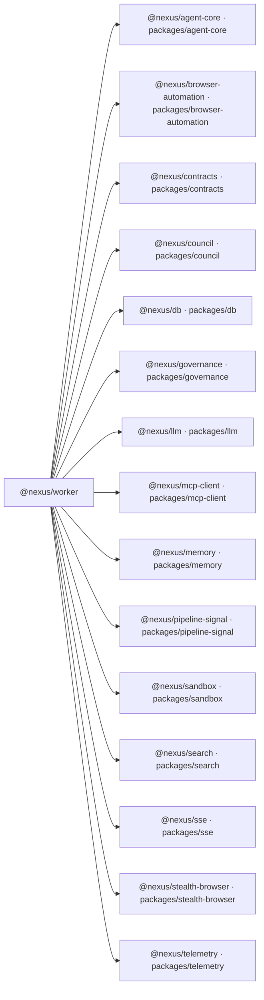
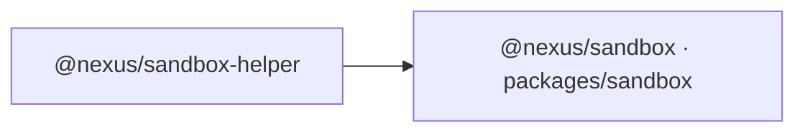
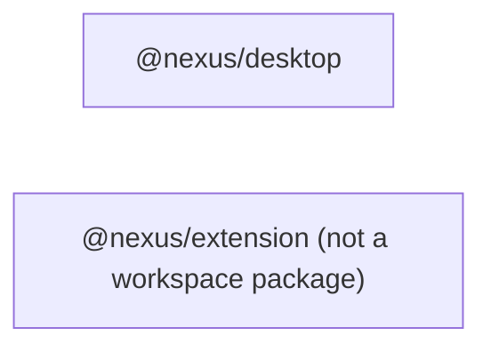

<!-- SPDX-License-Identifier: Apache-2.0 -->
<!-- verified: 1410186 2026-11-26 -->

# Nexus — Architecture & Repository Layout

How the apps, packages, and infrastructure fit together. For per-feature detail see
[FEATURES.md](FEATURES.md); for the design history see the [ADRs](adr/).

## System diagram

```
┌─────────────────────────────────────────────────────────────────────────────┐
│                              Nexus monorepo                                 │
│                                                                             │
│  ┌──────────────┐   ┌───────────────────┐   ┌──────────────────────────┐    │
│  │  services/   │   │    apps/api       │   │      apps/worker         │    │
│  │   ingest     │──▶│  (Fastify)        │──▶│  BullMQ high/med/low     │    │
│  │  (Python)    │   │  REST + SSE + MCP │   │  signal + task queues    │    │
│  └──────────────┘   └────────┬──────────┘   │  repeatable feed jobs    │    │
│         │                    │              └──────────────────────────┘    │
│  adapters emit               │ REST/SSE                                     │
│  ingested_events             ▼                                              │
│         │           ┌──────────────┐   ┌──────────────────────────────┐     │
│         │           │   apps/ui    │   │    apps/cli, apps/desktop    │     │
│         │           │ (React RR8)  │   │  commander CLI · Electron    │     │
│         │           └──────────────┘   └──────────────────────────────┘     │
│         ▼                                                                   │
│  ┌──────────────────────────────────────────────────────────────────────┐   │
│  │                         packages/ (49)                               │   │
│  │                                                                      │   │
│  │  ┌────────────────┐  ┌──────────────┐  ┌────────────────────────┐    │   │
│  │  │   agent-core   │  │   council    │  │          llm           │    │   │
│  │  │ multi-step     │  │ multi-model  │  │  49 provider drivers   │    │   │
│  │  │ tool loop +    │  │ voting with  │  │  native SSE/NDJSON     │    │   │
│  │  │ workflow layer │  │ allSettled   │  │  streaming             │    │   │
│  │  └────────────────┘  └──────────────┘  └────────────────────────┘    │   │
│  │                                                                      │   │
│  │  ┌────────────────┐  ┌──────────────┐  ┌────────────────────────┐    │   │
│  │  │   mcp-client   │  │   sandbox    │  │        search          │    │   │
│  │  │ JSON-RPC 2.0   │  │ Docker image │  │  hybrid BM25 + RRF     │    │   │
│  │  │ HTTP transport │  │ fail-closed  │  │  GraphRAG, rerank      │    │   │
│  │  └────────────────┘  └──────────────┘  └────────────────────────┘    │   │
│  │                                                                      │   │
│  │  ┌────────────────┐  ┌──────────────┐  ┌────────────────────────┐    │   │
│  │  │    memory      │  │  telemetry   │  │      plugin-sdk        │    │   │
│  │  │ pgvector +     │  │ OTel + HMAC  │  │  defineAdapter()       │    │   │
│  │  │ MemoryGraph    │  │ audit log    │  │  + test harness        │    │   │
│  │  └────────────────┘  └──────────────┘  └────────────────────────┘    │   │
│  │                                                                      │   │
│  │  governance · hooks · kv · llm-cache · llm-oauth · llm-tracer ·      │   │
│  │  feature-flags · doc-pipeline · nlp-utils · pipeline-signal ·        │   │
│  │  stream-recovery · stealth-browser · researcher ·                    │   │
│  │  browser-automation · session-sync · pty · exec-policy ·             │   │
│  │  search-orchestrator · llm-accounts · mcp-openapi · ...              │   │
│  └──────────────────────────────────────────────────────────────────────┘   │
│                                                                             │
│  PostgreSQL (pgvector) · Redis (BullMQ) · Docker (sandbox image)            │
│  Prometheus · Grafana · OpenTelemetry (OTLP) · Jaeger                       │
└─────────────────────────────────────────────────────────────────────────────┘
```

## Repository layout

```
nexus/
├── apps/
│   ├── api/            Fastify HTTP/SSE/WebSocket gateway (90 route modules)
│   ├── cli/            Developer CLI (commander.js)
│   ├── desktop/        Electron shell
│   ├── extension/      Browser extension around the search widget
│   ├── sandbox-helper/ Loopback runner the browser page calls for local Docker
│   ├── ui/             React Router 8 dashboard (43 routes)
│   └── worker/         BullMQ workers — signal, task, and repeatable drive jobs
├── packages/           49 scoped @nexus/* packages
│   ├── agent-core/             Multi-step tool loop, workflows, planning
│   ├── council/                Multi-model voting (unanimous/majority/weighted)
│   ├── llm/                    49 provider drivers, native SSE streaming
│   ├── gateway/                IProvider, FallbackChain, classifyFailoverError()
│   ├── mcp-client/             JSON-RPC 2.0 MCP consumer
│   ├── mcp-openapi/            OpenAPI → MCP tool auto-generation
│   ├── sandbox/                Untrusted-code runner (Docker image, fail-closed)
│   ├── search/                 Hybrid retrieval, GraphRAG, knowledge graph
│   ├── memory/                 pgvector, MemoryGraph BFS, HNSW ANN
│   ├── doc-pipeline/           extract → classify → OCR → index
│   ├── researcher/             Research agent over search + documents
│   ├── stealth-browser/        PatchrightDriver + Redis Streams
│   ├── browser-automation/     Scripted browser sessions
│   ├── rlhf-pipeline/          RLHF data pipeline
│   ├── telemetry/              OTel, HMAC-chained audit log, Prometheus
│   ├── auth/                   API key + JWT (HS256/RS256), login throttle,
│   │                           session revocation, Fastify preHandler
│   ├── db/                     Drizzle ORM — typed schemas + migrations
│   ├── contracts/              Generated OpenAPI types
│   ├── plugin-sdk/             defineAdapter(), ISocialProvider, test harness
│   └── ...                     billing, bots, kv, pty, sdk, sse, and the rest
├── services/
│   ├── board/          Go service
│   └── ingest/         Python (FastAPI + Celery) — adapter runners → DB
├── infra/
│   ├── docker/         docker-compose.dev/observability
│   ├── grafana/        Pre-provisioned dashboards
│   ├── k6/             Smoke and load test scripts
│   ├── otel/           OTel Collector, Prometheus, datasource configs
│   ├── sandbox/        Untrusted-code image (Node, Python, Go, Rust, Ruby)
│   ├── searxng/        Self-hosted metasearch configuration
│   └── web/            Production web image used by render.yaml
├── docs/               This directory — guides, ADRs, runbook, SLOs, security
├── docker-compose.yml  Local dev stack (postgres, redis, api, optional tools)
└── .env.example        Complete environment variable reference
```

## Toolchain

- **Node** 26 (`.nvmrc` pins `26`; engines require `>=24`)
- **pnpm** 12.x (`packageManager: pnpm@12.21.0`) — always pnpm, never npm/yarn
- **TypeScript** 6.x
- **Turbo** 2.x orchestrates all cross-package tasks (`dependsOn: ["^build"]`)
- **Postgres** (pgvector) + **Redis** (BullMQ) via Docker Compose for runtime

## Key design decisions

The ADRs live in [`docs/adr/`](adr/) — one decision each, most recent first when you read the
list of files. Notable:

- ADR-0002: Postgres as the only state store
- ADR-0004: pgvector over a dedicated vector DB
- ADR-0007: `Promise.allSettled` for council fanout (no cascade failure)
- ADR-0010: HMAC-chained audit log for tamper evidence
- ADR-0015: Piston for multi-language execution outside the Docker sandbox
- ADR-0018: BullMQ repeatable jobs for domain feed polling
- ADR-0022: versioned `v1:` secret envelopes, so rotation can run without downtime
- ADR-0024: budgets and retention, with the enforcer named in the same table
- ADR-0025: fold single-consumer packages, keep the boundaries that earn their keep

## Layer diagrams

<!-- begin:generated layers (scripts/arch-diagrams.mjs) -->

### API (apps/api)

```mermaid
graph LR
  pkg_api["@nexus/api"]
  pkg_adaptive_scraper["@nexus/adaptive-scraper · packages/adaptive-scraper"]
  pkg_api --> pkg_adaptive_scraper
  pkg_admin_gateway["@nexus/admin-gateway · packages/admin-gateway"]
  pkg_api --> pkg_admin_gateway
  pkg_agent_core["@nexus/agent-core · packages/agent-core"]
  pkg_api --> pkg_agent_core
  pkg_auth["@nexus/auth · packages/auth"]
  pkg_api --> pkg_auth
  pkg_billing["@nexus/billing · packages/billing"]
  pkg_api --> pkg_billing
  pkg_bots["@nexus/bots · packages/bots"]
  pkg_api --> pkg_bots
  pkg_browser_automation["@nexus/browser-automation · packages/browser-automation"]
  pkg_api --> pkg_browser_automation
  pkg_code_repl["@nexus/code-repl · packages/code-repl"]
  pkg_api --> pkg_code_repl
  pkg_contracts["@nexus/contracts · packages/contracts"]
  pkg_api --> pkg_contracts
  pkg_council["@nexus/council · packages/council"]
  pkg_api --> pkg_council
  pkg_db["@nexus/db · packages/db"]
  pkg_api --> pkg_db
  pkg_doc_pipeline["@nexus/doc-pipeline · packages/doc-pipeline"]
  pkg_api --> pkg_doc_pipeline
  pkg_exec_policy["@nexus/exec-policy · packages/exec-policy"]
  pkg_api --> pkg_exec_policy
  pkg_feature_flags["@nexus/feature-flags · packages/feature-flags"]
  pkg_api --> pkg_feature_flags
  pkg_gateway["@nexus/gateway · packages/gateway"]
  pkg_api --> pkg_gateway
  pkg_hooks["@nexus/hooks · packages/hooks"]
  pkg_api --> pkg_hooks
  pkg_kv["@nexus/kv · packages/kv"]
  pkg_api --> pkg_kv
  pkg_llm["@nexus/llm · packages/llm"]
  pkg_api --> pkg_llm
  pkg_llm_accounts["@nexus/llm-accounts · packages/llm-accounts"]
  pkg_api --> pkg_llm_accounts
  pkg_llm_cache["@nexus/llm-cache · packages/llm-cache"]
  pkg_api --> pkg_llm_cache
  pkg_llm_oauth["@nexus/llm-oauth · packages/llm-oauth"]
  pkg_api --> pkg_llm_oauth
  pkg_llm_tracer["@nexus/llm-tracer · packages/llm-tracer"]
  pkg_api --> pkg_llm_tracer
  pkg_lsp["@nexus/lsp · packages/lsp"]
  pkg_api --> pkg_lsp
  pkg_mail_ingest["@nexus/mail-ingest · packages/mail-ingest"]
  pkg_api --> pkg_mail_ingest
  pkg_mcp_client["@nexus/mcp-client · packages/mcp-client"]
  pkg_api --> pkg_mcp_client
  pkg_mcp_openapi["@nexus/mcp-openapi · packages/mcp-openapi"]
  pkg_api --> pkg_mcp_openapi
  pkg_memory["@nexus/memory · packages/memory"]
  pkg_api --> pkg_memory
  pkg_nlp_utils["@nexus/nlp-utils · packages/nlp-utils"]
  pkg_api --> pkg_nlp_utils
  pkg_plugin_sdk["@nexus/plugin-sdk · packages/plugin-sdk"]
  pkg_api --> pkg_plugin_sdk
  pkg_pty["@nexus/pty · packages/pty"]
  pkg_api --> pkg_pty
  pkg_researcher["@nexus/researcher · packages/researcher"]
  pkg_api --> pkg_researcher
  pkg_rlhf_pipeline["@nexus/rlhf-pipeline · packages/rlhf-pipeline"]
  pkg_api --> pkg_rlhf_pipeline
  pkg_sandbox["@nexus/sandbox · packages/sandbox"]
  pkg_api --> pkg_sandbox
  pkg_scraping_mcp["@nexus/scraping-mcp · packages/scraping-mcp"]
  pkg_api --> pkg_scraping_mcp
  pkg_sdk["@nexus/sdk · packages/sdk"]
  pkg_api --> pkg_sdk
  pkg_search["@nexus/search · packages/search"]
  pkg_api --> pkg_search
  pkg_search_orchestrator["@nexus/search-orchestrator · packages/search-orchestrator"]
  pkg_api --> pkg_search_orchestrator
  pkg_session_sync["@nexus/session-sync · packages/session-sync"]
  pkg_api --> pkg_session_sync
  pkg_shared["@nexus/shared · packages/shared"]
  pkg_api --> pkg_shared
  pkg_sse["@nexus/sse · packages/sse"]
  pkg_api --> pkg_sse
  pkg_stealth_browser["@nexus/stealth-browser · packages/stealth-browser"]
  pkg_api --> pkg_stealth_browser
  pkg_stream_recovery["@nexus/stream-recovery · packages/stream-recovery"]
  pkg_api --> pkg_stream_recovery
  pkg_telemetry["@nexus/telemetry · packages/telemetry"]
  pkg_api --> pkg_telemetry
  pkg_worker["@nexus/worker · apps/worker"]
  pkg_api --> pkg_worker
```



### Worker (apps/worker)



### UI (apps/ui)


### Sandbox (apps/sandbox-helper + @nexus/sandbox)



### Desktop and extension (apps/desktop, apps/extension)



### Durability classes

Declared per route in `apps/api/src/lib/api-maturity.ts` and asserted by
`apps/api/tests/lib/durable-bridge.test.ts`: `durable` writes survive a restart,
`bridge` mutates through to a durable store before answering, and
`dedicated-volatile` is deliberately not durable.

### Packages with one consumer

Measured, not chosen: these packages are imported by exactly one workspace package,
so folding them into that consumer removes a `package.json` without a design debate.
A package with two consumers is a real boundary; these are candidates, in the order
the count grows.

| Package                      | Only consumer   |
| ---------------------------- | --------------- |
| `@nexus/adaptive-scraper`    | `@nexus/api`    |
| `@nexus/admin-gateway`       | `@nexus/api`    |
| `@nexus/auth`                | `@nexus/api`    |
| `@nexus/billing`             | `@nexus/api`    |
| `@nexus/bots`                | `@nexus/api`    |
| `@nexus/code-repl`           | `@nexus/api`    |
| `@nexus/doc-pipeline`        | `@nexus/api`    |
| `@nexus/exec-policy`         | `@nexus/api`    |
| `@nexus/feature-flags`       | `@nexus/api`    |
| `@nexus/gateway`             | `@nexus/api`    |
| `@nexus/hooks`               | `@nexus/api`    |
| `@nexus/kv`                  | `@nexus/api`    |
| `@nexus/llm-accounts`        | `@nexus/api`    |
| `@nexus/llm-cache`           | `@nexus/api`    |
| `@nexus/llm-oauth`           | `@nexus/api`    |
| `@nexus/llm-tracer`          | `@nexus/api`    |
| `@nexus/mail-ingest`         | `@nexus/api`    |
| `@nexus/mcp-openapi`         | `@nexus/api`    |
| `@nexus/pipeline-signal`     | `@nexus/worker` |
| `@nexus/pty`                 | `@nexus/api`    |
| `@nexus/researcher`          | `@nexus/api`    |
| `@nexus/rlhf-pipeline`       | `@nexus/api`    |
| `@nexus/scraping-mcp`        | `@nexus/api`    |
| `@nexus/sdk`                 | `@nexus/api`    |
| `@nexus/search-orchestrator` | `@nexus/api`    |
| `@nexus/session-sync`        | `@nexus/api`    |
| `@nexus/worker`              | `@nexus/api`    |

#### `apps/api/src/lib` by domain

The same rule set keeps `scripts/lib-inventory.mjs` honest: every module in
`apps/api/src/lib` belongs to exactly one domain, and a module no test names is on a
list that may only shrink.

| Domain         | Modules | What it is for                                   |
| -------------- | ------- | ------------------------------------------------ |
| `runtime`      | 18      | schedules work inside this process               |
| `api-shape`    | 3       | defines the HTTP contract                        |
| `storage`      | 21      | owns rows or files that outlive the process      |
| `security`     | 27      | decides whether a caller may do something        |
| `org`          | 21      | the company-of-agents surfaces                   |
| `integrations` | 7       | speaks a protocol that is not ours               |
| `models`       | 16      | talks to a model provider or routes between them |
| `skills`       | 5       | imports, compresses or runs a skill              |

<!-- end:generated layers -->
